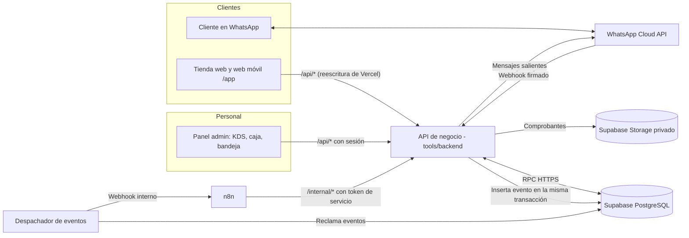
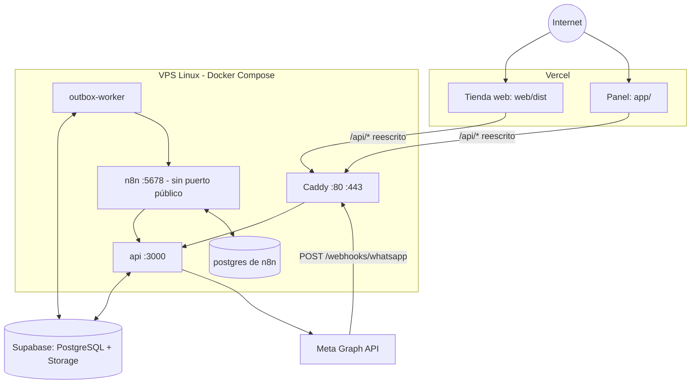
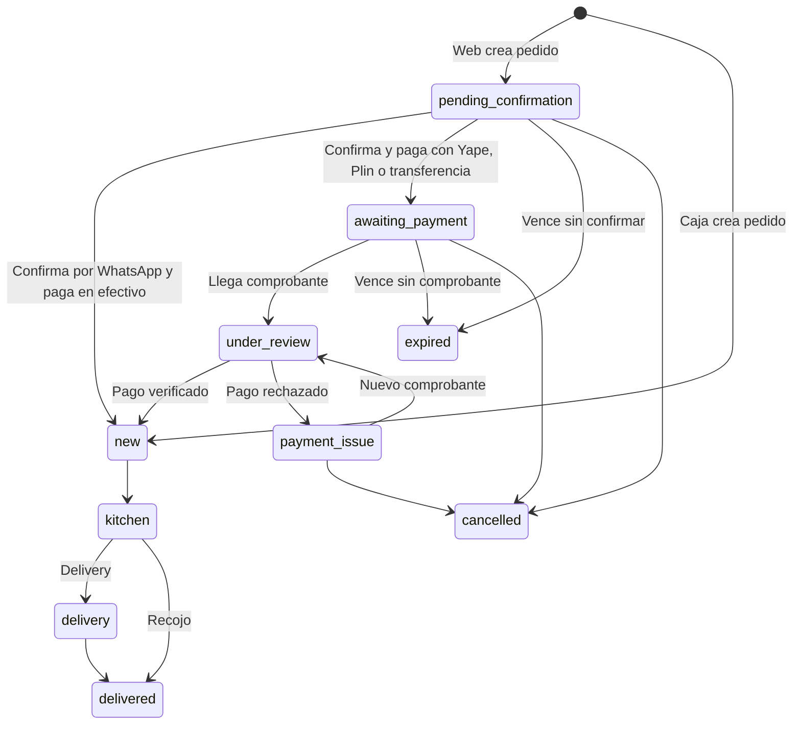

# Arquitectura de pedidos con n8n y WhatsApp — RETEQUE-OS

> **Documento de diseño técnico · Versión 2.0 · 2 de noviembre de 2026**
> **Base:** adapta la versión 1.0 («Arquitectura de automatización de pedidos por WhatsApp con n8n y VPS», 26 de octubre de 2026), escrita para un restaurante genérico, al estado real del repositorio RETEQUE-OS.
> **Estado:** arquitectura objetivo. Cada sección distingue lo que **existe hoy** de lo que está **por implementar**. Nada de lo marcado como «por implementar» está desplegado.

---

## 0. Resumen

RETEQUE-OS es el ecosistema digital de **Retequeños** (Calle Alto Lima 1488, Tacna). Tiene tres puntos de contacto con el cliente y el personal, más un backend propio:

| Pieza | Qué es | Dónde está en el repositorio |
|---|---|---|
| Tienda web pública | React + Vite + Tailwind + Zustand. Versión de escritorio (`/`, `/tequenos`, `/pizzas`…) y **web móvil de clientes** (`/app/*`, instalable como PWA con `web/public/manifest.webmanifest`) dentro de la misma aplicación. | `web/` |
| Panel de administración | HTML + JavaScript por módulos: tablero de cocina (KDS), catálogo, caja, usuarios, reportes, promociones, encuestas. | `app/admin.html`, `app/js/admin/` |
| Backend de negocio | Node.js sin dependencias externas, separado en configuración, HTTP, autenticación, repositorios y rutas. | `tools/server.js`, `tools/backend/` |
| Orquestación | **n8n** autoalojado. Coordina conversaciones de WhatsApp, avisos y tareas programadas. **Por implementar.** | `automation/` (por crear) |

**Decisiones de esta versión:**

1. **La web crea el pedido en el servidor** con precios calculados por el backend y recibe un código (`RTQ-…`). WhatsApp se abre solo con ese código para confirmar y pagar. Los pedidos de la web no necesitan interpretar texto ni usar IA.
2. **n8n coordina, el backend decide.** n8n envía mensajes, avisos y recordatorios llamando a la API. Precios, estados, pagos y permisos viven en el backend y en PostgreSQL. n8n nunca escribe directamente en la base de datos del negocio.
3. **Se conservan el backend y el panel existentes.** No se reescriben en Fastify, NestJS ni Next.js, como proponía la versión 1.0. Se les agregan el webhook de Meta, las rutas internas para n8n, el *outbox* y la bandeja de comprobantes.
4. **Base de datos del negocio en Supabase (plan gratuito) durante el desarrollo.** Antes de producción hay que pasar al plan Pro o migrar a PostgreSQL propio (ver ADR-011).
5. **Una VPS Linux con Docker Compose** corre la API, el despachador de eventos y n8n. La tienda y el panel siguen en Vercel. Render se retira cuando la API funcione en la VPS.
6. **Comprobante recibido no es pago confirmado.** Se mantiene la regla actual: Yape, Plin y transferencia requieren verificación humana antes de cocina.

---

## 1. Alcance

### 1.1 Canales y actores

| Canal | Actor | Cómo crea o sigue un pedido |
|---|---|---|
| Web de escritorio y web móvil (`/app`) | Cliente | Arma el carrito, la API cotiza y crea el pedido, y se abre WhatsApp con el código. |
| WhatsApp (Cloud API de Meta) | Cliente | Confirma el pedido web con el código, recibe instrucciones de pago, envía el comprobante y recibe avisos de estado. En una fase posterior, también podrá pedir con texto libre. |
| Panel: caja | Cajero o administrador | Registra pedidos en el mostrador (`/api/caja/pedidos`, ya existe). |
| Panel: KDS y bandeja | Administrador, cajero y, más adelante, cocina | Revisa comprobantes, aprueba o rechaza pagos y mueve pedidos por cocina. |
| n8n | Proceso de servicio | Reacciona a eventos del backend y llama a la API interna. |

### 1.2 Fuera de alcance en esta versión

- Aprobar pagos solo con la imagen o con OCR.
- Cuentas de cliente reales. Hoy las rutas `/app/login`, `/app/register` y `/app/profile` simulan la autenticación. La identidad del cliente será su número de WhatsApp; las cuentas web quedan para una etapa posterior.
- Varias sedes, POS, facturación electrónica, campañas de marketing masivas.
- La app móvil heredada de `app/js/mobile/`: ningún HTML la carga y queda reemplazada por la web móvil `/app`. Se retirará en un commit propio.

---

## 2. Estado actual frente al objetivo

| Área | Existe hoy | Por implementar |
|---|---|---|
| Backend | Módulos en `tools/backend/`. `POST /api/pedidos` exige administrador. Caja calcula precios con el catálogo. El servidor no arranca con datos ilegibles. | Entrada pública de pedidos, webhook de Meta, rutas internas, *outbox*, pagos separados, auditoría. |
| Persistencia | JSON en `data/` (producción actual en Render). Repositorios para Supabase y una migración SQL con `products`, `store_config`, `orders`, `order_items` y `staff_users`, ya en el repositorio, probados con un PostgreSQL temporal y pendientes de probar contra Supabase. | Tablas de variantes, promociones, clientes, conversaciones, mensajes, pagos, evidencias, *outbox*, idempotencia, auditoría, zonas y horarios. |
| Catálogo | Precio plano por producto. Las presentaciones (10 o 20 unidades), salsas y adicionales se calculan **solo en el navegador** (`ProductConfiguratorModal`). | Variantes y modificadores en el servidor, para que la API calcule el precio de cualquier carrito. |
| Cupones | Escritos en `web/src/lib/coupons.ts` (`BIENVENIDO10`, `RETE10`, `FIESTA20`…) y por separado en el panel (`coupons.data.js` + `localStorage`). | Una sola tabla de promociones en el servidor, validada al cotizar. |
| Checkout web | Abre `wa.me` con el pedido completo en texto. No registra nada en el servidor (`web/src/lib/orderSync.ts` está desactivado a propósito). | `POST /api/public/orders` y luego `wa.me` solo con el código. |
| Autenticación del personal | Sesiones en memoria (se pierden al reiniciar), contraseñas scrypt, roles `admin` y `cashier`, PIN heredado opcional. | Sesiones persistentes, sin contraseñas por defecto, rol `kitchen`, token de servicio para n8n. |
| Panel | KDS con consultas cada 2.5 s, caja, catálogo, usuarios, reportes. Algunas pantallas usan datos locales (`orders.data.js`, `catalog.data.js`, `coupons.data.js`, `analytics.data.js`). | Bandeja de comprobantes, conversaciones y atención humana. Datos siempre desde la API. |
| Infraestructura | Vercel (`web/`, `app/`), Render (API, con `app/vercel.json` reescribiendo `/api`), Supabase en pruebas. | VPS con Docker Compose (Caddy, API, despachador, n8n, PostgreSQL de n8n). |

---

## 3. Arquitectura lógica

**Responsabilidades:**

- **API de negocio (`tools/backend`):** único punto que escribe datos del negocio. Calcula precios, valida transiciones de estado, verifica la firma de Meta, aplica idempotencia, guarda eventos en el *outbox* y envía los mensajes de WhatsApp. Es la única que conoce el token de Meta.
- **Despachador de eventos:** proceso separado que toma eventos pendientes del *outbox* y los entrega a n8n, con reintentos. Comparte el código y la imagen Docker de la API. **Por implementar** (`tools/outbox-worker.js`).
- **n8n:** decide qué hacer con cada evento: qué mensaje enviar, cuándo recordar, cuándo avisar al personal. Lo hace llamando a la API. No guarda estado del negocio.
- **Supabase:** PostgreSQL con las tablas del negocio y funciones SQL transaccionales, más un bucket privado para comprobantes.
- **Panel y web:** solo hablan con la API. Nunca con n8n ni directamente con Supabase.

---

## 4. Despliegue

| Dominio (ilustrativo) | Servicio | Exposición |
|---|---|---|
| `www.ejemplo.pe` | Tienda web en Vercel | Pública |
| `admin.ejemplo.pe` | Panel en Vercel | Pública, con inicio de sesión |
| `api.ejemplo.pe` | Caddy → API en la VPS | Pública solo para `/api/*`, `/webhooks/whatsapp` y `/health`. Caddy responde 404 a `/internal/*`. |
| (ninguno) | n8n | **No se publica.** El editor se usa por túnel SSH; los flujos se activan desde la red interna de Docker. |

- La tienda y el panel siguen llamando a `/api/*` con la misma ruta relativa. Solo cambia el destino de la reescritura de `app/vercel.json` (hoy `reteque-os.onrender.com`). Así se conservan la cookie `rtq_admin_token` y los contratos actuales.
- Meta llama directamente a `api.ejemplo.pe`, sin pasar por Vercel.
- El detalle del sistema operativo (procesos, memoria, red, almacenamiento y respaldos) está en `documentacion/SO2_DISENO_DESPLIEGUE_N8N.md`.

---

## 5. Flujos de extremo a extremo

### F1. Pedido desde la web (escritorio o móvil)

1. Mientras el cliente arma el carrito, la web pide una cotización: `POST /api/public/quote` con `productId`, variante, adicionales, cantidad, zona y cupón. La API responde con el desglose y el total.
2. Al confirmar, la web envía `POST /api/public/orders` con la cabecera `Idempotency-Key` (un UUID generado por la pestaña) y los datos del cliente: nombre, teléfono, modalidad, dirección o zona, medio de pago y notas.
3. La API recalcula todo desde el catálogo. Ignora precios, totales, estados y verificaciones que envíe el cliente. Crea el pedido en estado `pending_confirmation` con un código `RTQ-XXXXXXXXXXXX` (12 caracteres hexadecimales) y un vencimiento (por ejemplo, 30 minutos).
4. La web abre `https://wa.me/51912266950?text=Hola%2C%20quiero%20confirmar%20mi%20pedido%20RTQ-…`.
5. Si la petición se repite con la misma `Idempotency-Key`, la API devuelve el mismo pedido y no crea otro.

### F2. Confirmación por WhatsApp

1. El cliente envía el mensaje con el código. Meta llama a `POST /webhooks/whatsapp`.
2. La API verifica `X-Hub-Signature-256` sobre los bytes originales del cuerpo, guarda el mensaje (único por `wamid`) y un evento `whatsapp.message_received` en la misma transacción. Responde 200.
3. El despachador entrega el evento a n8n (`WF-01`). n8n detecta el código y llama a `POST /internal/orders/:code/customer-confirm` con el `wa_id`.
4. La API valida que el pedido esté en `pending_confirmation` y sin vencer, lo asocia a la conversación y registra si el teléfono de WhatsApp coincide con el que se ingresó en la web. Si no coincide, lo marca para revisión, sin rechazarlo.
5. Según el medio de pago:
   - **Efectivo (recojo o contraentrega):** el pedido pasa a `new` y aparece en la columna «Nuevos» del KDS, como hoy.
   - **Yape, Plin o transferencia:** el pedido pasa a `awaiting_payment` y se emite `payment.requested`. n8n (`WF-03`) pide a la API que envíe las instrucciones: número de Yape y titular desde `store_config`, total exacto y código.

### F3. Comprobante y verificación

1. El cliente envía una imagen o un PDF. El webhook trae `media.id`, no el archivo.
2. La API descarga el archivo desde la Graph API, valida el tipo real y el tamaño, calcula `sha256`, lo guarda en el bucket privado de Supabase Storage y crea `payment_evidence`. El pago pasa a `under_review` y se emite `payment.proof_received`.
3. n8n (`WF-04`) pide a la API el acuse para el cliente («Recibimos tu comprobante… lo estamos verificando») y puede avisar al personal.
4. El panel muestra la bandeja de comprobantes, consultando cada 5 segundos.
5. El cajero o administrador comprueba el abono en la app de Yape o en el banco y pulsa **Aprobar** (`POST /api/payments/:id/verify`) o **Rechazar** (`/reject`, con motivo). La API registra quién lo hizo y cuándo, y usa una actualización condicional por `version` para que dos personas no aprueben a la vez.
6. Si se aprueba, el pedido pasa a `new` y se emite `payment.verified`; n8n (`WF-05`) confirma al cliente. Si se rechaza, pasa a `payment_issue` y n8n pide una aclaración.

### F4. Cocina y avisos de estado

El KDS mueve el pedido igual que hoy (`new → kitchen → delivery → delivered`, o `kitchen → delivered` en recojo). Cada cambio emite `order.status_changed`. n8n (`WF-06`) avisa al cliente: «en preparación», «en camino», «entregado». Dentro de las 24 horas desde el último mensaje del cliente se envían mensajes de servicio; fuera de esa ventana, solo plantillas aprobadas por Meta.

### F5. Caja

Sin cambios de fondo: `/api/caja/pedidos` crea el pedido directamente en `new`. El pago en efectivo no requiere verificación; Yape, Plin y transferencia siguen necesitando «Verificar pago» antes de cocina. Si se registró un teléfono, n8n puede enviar avisos de estado siempre que exista consentimiento.

### F6. Vencimiento

n8n (`WF-07`, disparador programado cada 5 minutos) llama a `POST /internal/orders/expire-stale`. La API pasa a `expired` los pedidos `pending_confirmation` vencidos. Los `awaiting_payment` sin comprobante tras un plazo configurable reciben un recordatorio y, después, se vencen.

### F7. Atención humana

Si el cliente escribe «asesor», «persona» o algo similar, o si n8n no entiende el mensaje dos veces, `WF-08` llama a `POST /internal/conversations/:id/handoff`. La conversación queda en pausa para el bot y aparece en el panel. Mientras siga en pausa, n8n no responde automáticamente.

### F8. Pedido por texto libre (fase posterior)

«Quiero 20 tequeños de queso con dos de ají y una Inca Kola». Se resuelve con reglas y alias del catálogo y, si hace falta, con IA para extraer un JSON validado (sección 12). La API cotiza y crea el pedido igual que en F1. **No forma parte del MVP.**

---

## 6. Estados

### 6.1 Pedido (`orders.status`)

Se amplía el conjunto actual (`new`, `kitchen`, `delivery`, `delivered`) sin cambiar el significado de esos cuatro. Así el KDS sigue funcionando.

| Estado | Columna del KDS | Quién lo cambia |
|---|---|---|
| `pending_confirmation`, `awaiting_payment`, `under_review`, `payment_issue` | No aparece en el KDS; sí en la bandeja | API, por eventos de WhatsApp o del personal |
| `new`, `kitchen`, `delivery`, `delivered` | Igual que hoy | Personal desde el KDS (las reglas de caja existentes se mantienen) |
| `expired`, `cancelled` | Historial | API (vencimiento) o administrador |

### 6.2 Pago (`payments.status`)

`not_required` (efectivo) · `pending` · `under_review` · `verified` · `rejected`. El campo actual `payVerified` se mantiene durante la transición, calculado como `payments.status = 'verified'`, para no romper el panel ni los reportes (`tools/reports.js`).

**Regla:** solo una persona con rol `admin` o `cashier` puede pasar un pago a `verified`. Ni n8n, ni la IA, ni la llegada de un archivo pueden hacerlo.

---

## 7. Modelo de datos

**Existe (migraciones en `supabase/migrations/`):** `products`, `store_config`, `orders`, `order_items` y `staff_users`, con RLS activado, permisos solo para `service_role`, dinero en `numeric(10,2)` y funciones `rtq_repository` y `rtq_write_order` para operaciones transaccionales.

**Por agregar:**

| Tabla | Propósito | Columnas clave |
|---|---|---|
| `product_options` | Presentaciones, salsas incluidas, adicionales | `id`, `product_id`, `group` (`presentation`, `sauce`, `upgrade`), `name`, `price_delta`, `included_qty`, `available` |
| `promotions` | Cupones y promociones vigentes (reemplaza `coupons.ts` y `coupons.data.js`) | `code` único, `type` (`fixed`, `percent`), `value`, `min_order`, `starts_at`, `ends_at`, `max_uses`, `active` |
| `delivery_zones` | Tarifa de delivery por zona de Tacna | `id`, `name`, `fee`, `active` |
| `business_hours` | Horario estructurado (hoy es un texto en `store_config.hours`) | `weekday`, `opens_at`, `closes_at` |
| `customers` | Identidad por WhatsApp | `id`, `wa_id` único, `name`, `phone`, `opt_in_at`, `opt_out_at` |
| `conversations` | Estado del bot y atención humana | `id`, `customer_id`, `active_order_id`, `bot_paused`, `assigned_to`, `last_customer_message_at` |
| `messages` | Entrada y salida de WhatsApp | `id`, `wamid` único, `direction`, `kind`, `payload` (sanitizado), `delivery_status` |
| `payments` | Pago separado del pedido | `id`, `order_id`, `method`, `expected_amount`, `status`, `verified_by`, `verified_at`, `version` |
| `payment_evidence` | Comprobantes | `id`, `payment_id`, `storage_key`, `mime_type`, `size_bytes`, `sha256` (índice para detectar reutilización), `review_status` |
| `event_outbox` | Eventos para n8n | `id` (UUID), `event_type`, `aggregate_id`, `payload`, `status`, `attempts`, `next_attempt_at`, `locked_until`, `locked_by`, `last_error` |
| `idempotency_keys` | Peticiones repetidas | `key` único, `scope`, `response`, `created_at` |
| `audit_log` | Acciones críticas | `actor`, `action`, `entity`, `before`, `after`, `at` |

A `orders` se le agregan `version` (control optimista), `expires_at`, `conversation_id` y `phone_mismatch`.

---

## 8. Contratos de la API

### 8.1 Existentes (se conservan)

`GET /api/catalog`, `GET /api/config`, `POST /api/auth/login|logout`, `GET /api/auth/verify`, `GET /api/pedidos` (personal), `GET /api/pedidos/:id` (seguimiento público mínimo), `PATCH /api/pedidos/:id` (estado o verificación), `POST /api/pedidos` (solo administrador), `POST /api/caja/pedidos`, `/api/users`, `/api/reports`, gestión de catálogo y configuración.

### 8.2 Nuevos

| Ruta | Uso | Seguridad |
|---|---|---|
| `POST /api/public/quote` | Cotizar un carrito sin crear el pedido | Pública, límite por IP |
| `POST /api/public/orders` | Crear pedido web en `pending_confirmation` | Pública, `Idempotency-Key` obligatoria, límite por IP y por teléfono |
| `GET /api/public/orders/:code` | Seguimiento por código | Pública, sin datos personales |
| `GET /webhooks/whatsapp` | Verificación inicial de Meta (`hub.challenge`) | `META_WEBHOOK_VERIFY_TOKEN` |
| `POST /webhooks/whatsapp` | Mensajes y estados de entrega | HMAC-SHA256 sobre el cuerpo original con `META_APP_SECRET` |
| `GET /internal/conversations/by-wa/:waId` | Contexto para n8n: pedido activo, estado, pausa | Token de servicio; solo red interna |
| `POST /internal/orders/:code/customer-confirm` | Confirmación del cliente | Token de servicio + idempotencia |
| `POST /internal/messages` | Pedir un envío por WhatsApp (texto o plantilla) | Token de servicio + idempotencia + regla de 24 horas |
| `POST /internal/orders/expire-stale` | Vencimientos | Token de servicio |
| `POST /internal/conversations/:id/handoff` | Atención humana | Token de servicio |
| `GET /api/payments?status=under_review` | Bandeja de comprobantes | Sesión `admin` o `cashier` |
| `POST /api/payments/:id/verify` · `/reject` | Decisión de pago | Sesión `admin` o `cashier`, `version` esperada, auditoría |
| `GET /api/attachments/:id/view` | URL firmada de corta duración al comprobante | Sesión `admin` o `cashier` |
| `GET /health` · `GET /ready` | Salud del proceso y de sus dependencias | `/ready` solo interno |

---

## 9. Workflows de n8n

Cada workflow se versiona como JSON exportado en `automation/workflows/`, sin credenciales.

| Workflow | Disparador | Llamadas a la API | Resultado |
|---|---|---|---|
| `WF-01_entrada_whatsapp` | Webhook interno, evento `whatsapp.message_received` | `GET /internal/conversations/by-wa/:waId` | Enruta: código de pedido, comprobante, «asesor» o texto libre |
| `WF-02_confirmar_pedido_web` | Desde WF-01 (mensaje con `RTQ-…`) | `POST /internal/orders/:code/customer-confirm` | Pedido confirmado o mensaje de código inválido o vencido |
| `WF-03_instrucciones_pago` | `payment.requested` | `POST /internal/messages` | Instrucciones de Yape, Plin o transferencia con total y código |
| `WF-04_comprobante_recibido` | `payment.proof_received` | `POST /internal/messages` | Acuse al cliente, sin confirmar el pago |
| `WF-05_resultado_pago` | `payment.verified` / `payment.rejected` | `POST /internal/messages` | Confirmación o pedido de aclaración |
| `WF-06_avisos_estado` | `order.status_changed` | `POST /internal/messages` | «En preparación», «en camino», «entregado» |
| `WF-07_vencimientos` | Programado, cada 5 min | `POST /internal/orders/expire-stale` | Pedidos vencidos y recordatorios |
| `WF-08_atencion_humana` | Desde WF-01 o por ambigüedad repetida | `POST /internal/conversations/:id/handoff` | Bot en pausa y aviso al personal |
| `WF-09_errores` | *Error Trigger* de n8n | Aviso al administrador | Incidencia registrada |
| `WF-10_texto_libre` | Desde WF-01 (fase posterior) | `POST /api/public/quote` y creación de pedido | Pedido desde texto, con IA opcional |

**Reglas para todos los workflows:**

- El webhook interno usa la credencial *Header Auth* de n8n con un secreto compartido. Responde con un nodo *Respond to Webhook* al **final** del flujo, de modo que el despachador solo da por entregado el evento si n8n terminó bien.
- Cada llamada a la API lleva `Authorization: Bearer <token de servicio>` e `Idempotency-Key: <event_id>`. Si n8n reintenta, la API no duplica mensajes ni cambios.
- n8n no envía mensajes directamente a Meta: lo pide a la API, que aplica la ventana de 24 horas y registra cada envío.
- Los textos de los mensajes viven en n8n (son presentación); los importes, códigos y datos de pago vienen siempre de la API.

---

## 10. Eventos

**Entrega al menos una vez**, nunca «exactamente una vez». El evento se inserta en `event_outbox` dentro de la misma transacción que el cambio que lo origina. El despachador lo reclama con `FOR UPDATE SKIP LOCKED` y un plazo de reserva (`locked_until`). Si no hay confirmación, reintenta con espera exponencial; tras el máximo de intentos, lo marca `dead` y avisa.

| Evento | Origen | Campos principales (sin datos personales innecesarios) |
|---|---|---|
| `whatsapp.message_received` | Webhook de Meta | `event_id`, `wa_id`, `message_id`, `kind`, `text` |
| `order.created` | Web o caja | `order_code`, `channel`, `total` |
| `order.customer_confirmed` | Confirmación por WhatsApp | `order_code`, `pay_method` |
| `payment.requested` | Medio de pago no efectivo | `order_code`, `expected_amount` |
| `payment.proof_received` | Comprobante guardado | `order_code`, `payment_id`, `evidence_id` |
| `payment.verified` / `payment.rejected` | Panel | `order_code`, `payment_id`, `reason` (si es rechazo) |
| `order.status_changed` | KDS | `order_code`, `from`, `to` |
| `order.expired` | Vencimiento | `order_code` |
| `conversation.handoff_requested` | n8n o cliente | `conversation_id` |
| `message.delivery_failed` | Estado de entrega de Meta | `message_id`, `error_code` |

---

## 11. Seguridad y datos

| Riesgo o control | Diseño |
|---|---|
| Precios manipulados | La API calcula siempre desde `products`, `product_options`, `promotions` y `delivery_zones`. |
| Cupones expuestos | Se quitan de `web/src/lib/coupons.ts` y del `localStorage` del panel; se validan solo en el servidor. |
| Webhook falso de Meta | Firma HMAC sobre el cuerpo original. Hoy `readJsonBody` lee el cuerpo como texto, así que hace falta un lector que conserve los bytes originales para esa ruta. |
| Acceso a rutas internas | Caddy responde 404 a `/internal/*` desde Internet; n8n llama por la red interna de Docker (`http://api:3000/internal/...`) y además presenta un token de servicio. |
| Límite de intentos por IP | Detrás de Vercel y Caddy, `req.socket.remoteAddress` es la IP del proxy: el bloqueo tras 5 intentos fallidos y el límite de 30 pedidos por minuto afectarían a todos los clientes a la vez. Vercel no publica IP de salida fijas, así que la cabecera `X-Forwarded-For` no se puede verificar. Por eso el bloqueo de inicio de sesión pasa a ser **por usuario**, y el límite de pedidos públicos por teléfono y por la IP declarada, tratada como señal no confiable (detalle en `SO2_DISENO_DESPLIEGUE_N8N.md`, sección 8.5). **Debe corregirse antes de desplegar en la VPS.** |
| Sesiones del personal | Pasar de memoria a la base, con expiración y revocación; quitar el PIN heredado y las contraseñas `1234`. |
| Bloqueo del servidor al iniciar sesión | `crypto.scryptSync` detiene el bucle de eventos de Node. Medido en el equipo de desarrollo: 8 inicios de sesión seguidos bloquean 262 ms, frente a 11 ms con `crypto.scrypt` asíncrono. Usar la versión asíncrona en `users.repository.js` y `postgres.repositories.js`. |
| Secretos | `SUPABASE_SERVICE_ROLE_KEY`, `META_APP_SECRET`, `META_SYSTEM_USER_ACCESS_TOKEN`, `RTQ_N8N_SERVICE_TOKEN`, `N8N_ENCRYPTION_KEY`: solo en archivos `.env` de la VPS con permisos `600` y en las credenciales cifradas de n8n. Nunca en git ni en el navegador. |
| Comprobantes | Bucket privado, URL firmada de pocos minutos, sin miniaturas en canales públicos, retención limitada. |
| Datos personales (Ley N.º 29733) | Recoger solo lo necesario (nombre, teléfono, dirección si hay delivery). Aviso de privacidad en la web y en el primer mensaje. Documentar a Supabase, Meta y, si se usa, al proveedor de IA como encargados del tratamiento. |
| Licencia de n8n | Uso interno para un solo negocio, sin dar a terceros acceso al editor: compatible con la *Sustainable Use License*. Revisarla si se ofrece el sistema a otros restaurantes. |

---

## 12. WhatsApp e IA

**Meta.** Pasos de configuración, ventana de 24 horas, plantillas y precios: se mantienen las secciones 10.1 a 10.4 de la versión 1.0. Las tarifas que cita (1,000 mensajes de servicio gratis al mes por número y US$ 0.03 por mensaje desde el 1 de octubre de 2026) deben **verificarse en la tabla oficial vigente** antes de presupuestar. Hacen falta plantillas de utilidad para los avisos de estado que lleguen fuera de las 24 horas.

**IA.** No interviene en los pedidos de la web ni de caja, que ya llegan estructurados. Solo se evaluará para `WF-10` (texto libre), con salida JSON validada por la API y sin poder decidir precios, descuentos ni pagos. Los modelos que nombra la versión 1.0 (`gpt-6-luna`, `gemini-2.5-flash-lite`) y sus precios deben comprobarse en las páginas oficiales. La comparación con 50 a 100 mensajes reales anonimizados debe incluir al menos un modelo económico de un tercer proveedor.

---

## 13. Plan por etapas

| Etapa | Contenido | Estado |
|---|---|---|
| 0 | Backend modular, robustez, admisión de `POST /api/pedidos`, datos ilegibles | Hecho |
| 1 | Persistencia en Supabase (tablas base, migración de catálogo y configuración) | En curso: código y migraciones listos; falta probar contra Supabase |
| 2 | Catálogo con variantes, promociones y zonas en el servidor; `POST /api/public/quote` y `/orders`; la web usa el código y WhatsApp | Por hacer |
| 3 | Autenticación real del personal, rol `kitchen`, token de servicio, auditoría, IP de cliente correcta, scrypt asíncrono | Por hacer |
| 4 | VPS con Docker Compose (Caddy, API, despachador, n8n), *outbox*, retiro de Render | Por hacer |
| 5 | WhatsApp Cloud API: webhook firmado, mensajes, `WF-01` a `WF-03` y `WF-07` | Por hacer |
| 6 | Comprobantes, bandeja en el panel, `WF-04` a `WF-06` y `WF-08` | Por hacer |
| 7 | Endurecimiento: respaldos probados, monitoreo, pasar a Supabase Pro o a PostgreSQL propio, prueba de carga | Por hacer |
| 8 | Texto libre con IA (`WF-10`) | Opcional |

**Criterio de salida de la etapa 2** (equivale a la etapa 1 de la versión 1.0): desde la API, sin WhatsApp ni IA, se puede crear un pedido web con variantes y cupón, con el total correcto, y repetir la petición no lo duplica.

---

## 14. Decisiones de arquitectura

| ADR | Decisión | Motivo y costo |
|---|---|---|
| ADR-001 | WhatsApp Cloud API oficial | Cumplimiento y webhooks fiables; requiere configurar Meta y pagar por mensaje. |
| ADR-002 | n8n coordina; el backend concentra reglas y datos | Consistencia y pruebas; agrega un componente. |
| ADR-003 | IA opcional y solo para interpretar texto | Evita precios o pagos inventados. |
| ADR-004 | Comprobante no equivale a pago | Evita fraudes con capturas editadas o reutilizadas. |
| ADR-007 | *Outbox* e idempotencia | Resiste reenvíos de Meta y caídas de n8n. |
| ADR-011 | Supabase gratuito en desarrollo; Pro o PostgreSQL propio antes de producción | El plan gratuito se pausa tras días sin actividad (con la base pausada, la API deja de responder) y tiene límites de tamaño. Verificar los límites vigentes. El SQL de las migraciones sirve en cualquier PostgreSQL; si se migra, solo cambia el adaptador `supabase-rpc.js`. |
| ADR-012 | n8n sin exposición pública | Meta llama a la API, no a n8n; el editor se usa por túnel SSH. Reduce la superficie de ataque. |
| ADR-013 | La web crea el pedido en el servidor y WhatsApp solo lleva el código | Precios confiables y sin IA para los pedidos web; requiere la entrada pública con idempotencia. |
| ADR-014 | Se conservan el backend y el panel actuales | Ya están probados y modularizados; reescribirlos no aporta valor en el MVP. |
| ADR-015 | Se retira `app/js/mobile`; la web móvil es `/app` | Ningún HTML la carga y duplicaba la lógica de pedidos. |
| ADR-016 | La API y n8n en la VPS; la tienda y el panel en Vercel | Los webhooks de Meta necesitan un servidor siempre encendido; Vercel sigue sirviendo lo estático sin costo adicional. |

---

## 15. Pendientes antes de construir

- [ ] Zonas de delivery de Tacna y sus tarifas.
- [ ] Horario estructurado y política para pedidos fuera de horario.
- [ ] Catálogo definitivo con presentaciones, salsas incluidas y adicionales con precio.
- [ ] Promociones vigentes y quién puede crearlas.
- [ ] Número de WhatsApp: si el 51 912 266 950 puede conectarse a la Cloud API (y en qué modalidad de coexistencia) o se necesita otro número.
- [ ] Plazos de vencimiento: confirmación (propuesta: 30 min) y pago (propuesta: 60 min).
- [ ] Proveedor y tamaño de la VPS (propuesta: 2 vCPU, 4 GiB de RAM, Ubuntu Server LTS).
- [ ] Momento del paso a Supabase Pro o a PostgreSQL propio.
- [ ] Texto del aviso de privacidad y del consentimiento para avisos por WhatsApp.
