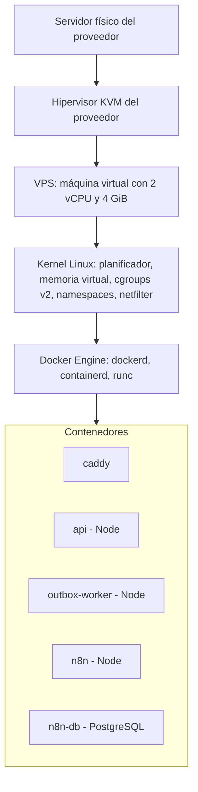
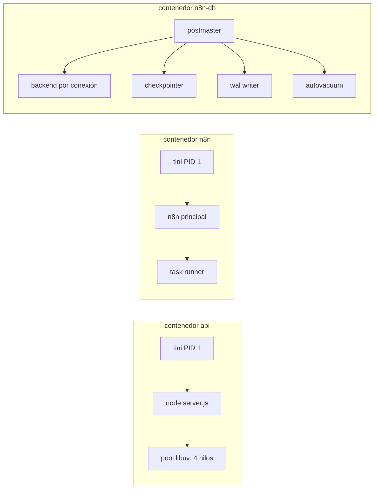
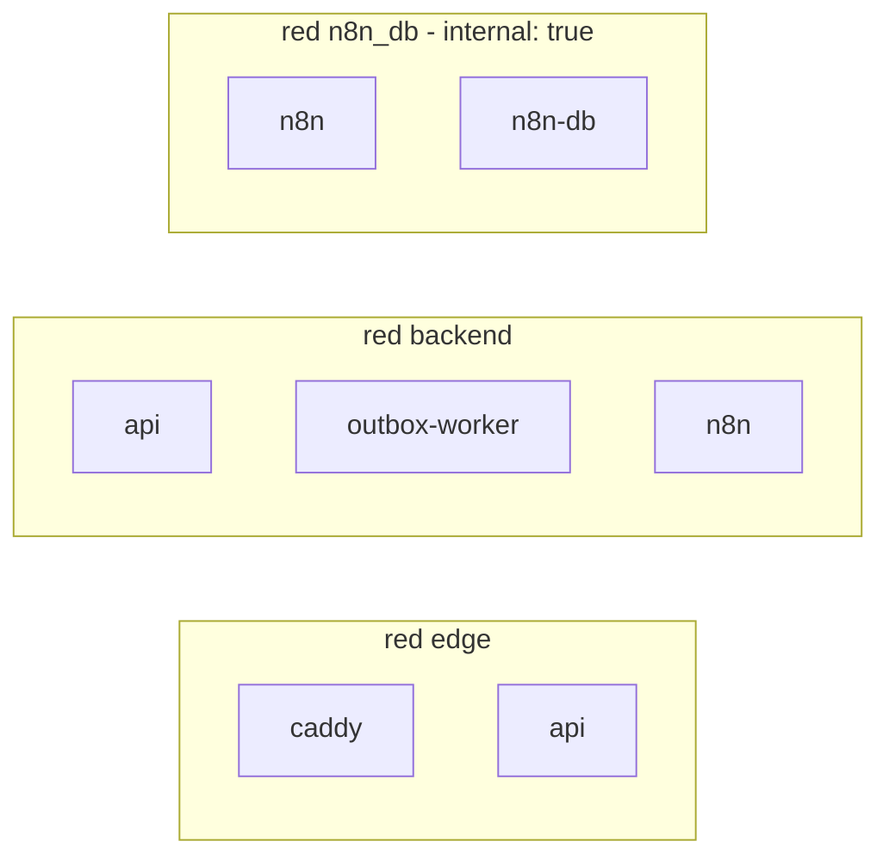
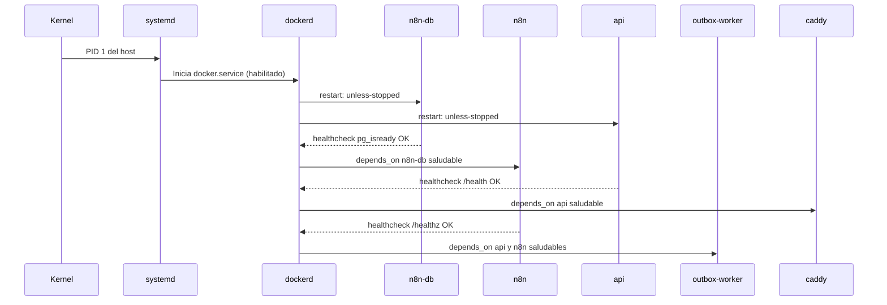

# Diseño y arquitectura de la implementación de n8n en RETEQUE-OS

> **Curso:** Sistemas Operativos II · **Proyecto:** RETEQUE-OS (Retequeños, Tacna)
> **Tema:** diseño del despliegue de n8n y de los servicios que lo rodean sobre Linux, analizado desde el sistema operativo.
> **Versión:** 1.0 · 2 de noviembre de 2026
> **Relación con otros documentos:** la arquitectura funcional (flujos, estados, API y workflows) está en `documentacion/ARQUITECTURA_N8N_WHATSAPP.md`. Este documento explica **cómo se ejecuta todo en el sistema operativo** y por qué.
> **Estado:** diseño. Los archivos de configuración de los anexos son de referencia y **aún no están desplegados**. Los hallazgos de la sección 2 sí provienen del código actual del repositorio.

---

## 1. Objetivo y requisitos

**Objetivo.** Ejecutar n8n como orquestador de pedidos y mensajes de WhatsApp en una VPS Linux, junto con la API de negocio que lo alimenta, de forma que el sistema:

| Requisito no funcional | Meta para el MVP | Mecanismo del sistema operativo que lo sostiene |
|---|---|---|
| Disponibilidad | Servicio activo 24/7; recuperación automática tras un fallo de proceso o un reinicio | `systemd`, políticas de reinicio de Docker, *healthchecks* |
| Latencia del webhook de Meta | Responder 200 en menos de 1 s tras guardar el evento | Bucle de eventos de Node sin bloqueos, trabajo pesado fuera de la petición |
| Durabilidad | Ningún evento aceptado se pierde | WAL de PostgreSQL, volúmenes persistentes, *outbox* |
| Aislamiento | Un fallo o abuso en n8n no compromete la API ni la base | *namespaces*, *cgroups*, redes separadas, usuarios sin privilegios |
| Seguridad | Solo 80 y 443 expuestos; secretos fuera de git | Cortafuegos, permisos de archivos, capacidades reducidas |
| Recuperación | RPO ≤ 24 h, RTO ≤ 2 h | Respaldos programados con `systemd` y prueba de restauración |

---

## 2. Hallazgos del código actual que condicionan el despliegue

Antes de diseñar el despliegue se revisó el backend (`tools/backend/`). Estos puntos son reales y se resuelven en el diseño:

| # | Hallazgo | Concepto de SO | Consecuencia | Decisión |
|---|---|---|---|---|
| H1 | La verificación de contraseñas usa `crypto.scryptSync` (`tools/users.repository.js`, `tools/backend/repositories/postgres.repositories.js`). | Llamada bloqueante en un proceso de un solo hilo de ejecución de JavaScript | Medido en el equipo de desarrollo (Node 24, 6 CPU lógicas): 8 inicios de sesión seguidos bloquean el bucle de eventos **262 ms**. Con `crypto.scrypt` asíncrono, que usa el *pool* de hilos de libuv, el bloqueo máximo fue de **11 ms** y el total bajó de 267 a 77 ms. | Usar `crypto.scrypt` asíncrono. Ver el experimento E3. |
| H2 | `tools/server.js` no maneja `SIGTERM` ni `SIGINT`. | Señales y el proceso PID 1 en un *namespace* | Dentro de un contenedor, Node es PID 1. El kernel no aplica la acción por defecto a las señales sin manejador dirigidas al *init* de un *namespace*: `docker stop` espera 10 s y luego envía `SIGKILL`, cortando las peticiones en curso. | `init: true` (tini como PID 1) y un manejador que cierre el servidor ordenadamente. Ver E4. |
| H3 | Los límites de intentos usan `req.socket.remoteAddress` (`auth.routes.js`, `orders.routes.js`). | Sockets y traducción de direcciones detrás de un proxy | Detrás de Caddy (y de Vercel en el caso de la web), todos los clientes comparten la IP del proxy. Cinco errores de contraseña de cualquier persona bloquearían a todo el personal durante 15 minutos. | Ver la sección 8.5. |
| H4 | El servidor escucha en `127.0.0.1` salvo que reciba `--lan`. | *Namespace* de red | Dentro de un contenedor, `127.0.0.1` es la interfaz de *loopback* del propio contenedor: Caddy no podría conectarse. | Iniciar con `--lan` (escucha en `0.0.0.0` **dentro** del contenedor) y no publicar el puerto en el host. |
| H5 | La persistencia JSON escribe un archivo temporal y luego hace `rename`, sin `fsync`. | Sistema de archivos, atomicidad frente a durabilidad | `rename` es atómico en el mismo sistema de archivos, pero sin `fsync` del archivo y del directorio un corte de energía puede dejar datos sin escribir. | Es una de las razones para pasar a PostgreSQL, que garantiza durabilidad con su registro WAL. |
| H6 | `GET /api/pedidos` trae **todos** los pedidos y la API los filtra en memoria; el KDS lo consulta cada 2.5 s. | Uso de red, memoria y CPU que crece con los datos | Con 50 pedidos al día, en un año serían unos 18 000 pedidos transferidos y procesados cada 2.5 s por cada panel abierto. | Filtrar por fecha y estado en la base y subir el intervalo a 5 s. Ver la sección 14. |
| H7 | Las sesiones del personal viven en un `Map` en memoria. | Estado en un solo proceso | Se pierden al reiniciar el contenedor y no se comparten si algún día hay más de un proceso de API. | Sesiones persistentes en la base (etapa de autenticación real). |

---

## 3. Vista general por capas



Hay dos niveles de virtualización:

- **Virtualización completa (la VPS).** El proveedor ejecuta un hipervisor (normalmente KVM) que presenta CPU, memoria y disco virtuales. La VPS tiene su propio kernel. Los recursos pueden estar sobrevendidos, así que el rendimiento de la CPU varía (*steal time*, visible como `st` en `top`).
- **Virtualización a nivel de sistema operativo (los contenedores).** Todos los contenedores **comparten el kernel de la VPS**. Un contenedor es un conjunto de procesos normales a los que el kernel les da:
  - una vista aislada mediante ***namespaces***: `pid`, `net`, `mnt`, `uts`, `ipc` y, opcionalmente, `user`;
  - límites de recursos mediante ***cgroups v2***: CPU, memoria, número de procesos y E/S;
  - un sistema de archivos en capas mediante ***overlay2***.

**Por qué contenedores y no instalar todo directamente en la VPS:**
- Versiones fijas e independientes: cada servicio trae su propia versión de Node o de PostgreSQL.
- Límites de recursos por servicio.
- Reinicio automático.
- Actualización y vuelta atrás cambiando solo la etiqueta de la imagen.
- Aislamiento de red entre servicios.

**Por qué no una máquina virtual por servicio:** con 4 GiB de RAM, el costo de varios kernels sería desproporcionado.

---

## 4. Sistema operativo base

| Aspecto | Decisión | Justificación |
|---|---|---|
| Distribución | Ubuntu Server LTS vigente (24.04 o 26.04) | Soporte de seguridad prolongado, kernel 6.x con cgroups v2 y el planificador EEVDF (Linux 6.6 en adelante). |
| Usuario de operación | `deploy`, con `sudo`; sin acceso SSH para `root` | Principio de mínimo privilegio y trazabilidad. Pertenecer al grupo `docker` equivale en la práctica a tener privilegios de root, porque permite montar el disco del host en un contenedor. Por eso se ejecuta `docker` con `sudo`, o se acepta ese riesgo de forma explícita. |
| SSH | Solo claves (`PasswordAuthentication no`, `PermitRootLogin no`); `fail2ban` | Evita ataques de fuerza bruta. |
| Cortafuegos | `ufw`: denegar todo lo entrante salvo 22 (idealmente desde IPs conocidas), 80 y 443 | Superficie mínima. Atención: Docker inserta sus propias reglas en iptables y **los puertos publicados con `ports:` no pasan por `ufw`**. Ver la sección 8.3. |
| Hora | `timedatectl set-timezone America/Lima` y sincronización NTP activa (`systemd-timesyncd`) | Los disparadores programados de n8n, los temporizadores de `systemd`, la validez de los certificados TLS y la correlación de registros dependen de un reloj correcto. |
| Actualizaciones | `unattended-upgrades` solo para parches de seguridad; reinicio del kernel en una ventana fuera del horario de atención (5 p. m. a 11 p. m.) | Equilibrio entre parches y disponibilidad. |
| Intercambio (*swap*) | Archivo de 2 GiB y `vm.swappiness=10` | Da margen ante picos de memoria sin que el sistema use el disco como RAM en condiciones normales. |

---

## 5. Procesos y modelo de ejecución

### 5.1 Inventario de procesos

| Contenedor | Proceso principal | Modelo de concurrencia | Observaciones |
|---|---|---|---|
| `caddy` | Binario en Go | *Goroutines* sobre varios hilos del sistema (modelo M:N) | Termina TLS y reenvía las peticiones a la API. |
| `api` | `node tools/server.js --port 3000 --lan` | Un hilo con bucle de eventos (libuv), más un *pool* de 4 hilos (`UV_THREADPOOL_SIZE`) para criptografía, DNS y operaciones de archivos | Toda la lógica de negocio. Una operación de CPU síncrona detiene **todas** las peticiones (H1). |
| `outbox-worker` | `node tools/outbox-worker.js` (**por implementar**) | Un hilo, bucle de consulta con espera | Proceso separado de la API: si falla, la API sigue atendiendo, y viceversa (aislamiento de fallos). |
| `n8n` | Proceso principal de n8n (Node) | Bucle de eventos; ejecuta workflows de forma concurrente hasta un límite configurable | Atiende el editor, los webhooks internos y el planificador de disparadores. El código de los nodos *Code* se ejecuta en un proceso aparte (*task runner*), según la versión de n8n. |
| `n8n-db` | PostgreSQL | **Un proceso por conexión**: el `postmaster` crea un proceso hijo por cliente, más procesos de fondo (*checkpointer*, *WAL writer*, *autovacuum*) | Base de datos propia de n8n (workflows, credenciales cifradas, historial de ejecuciones). Separada de la base del negocio. |



### 5.2 Modos de ejecución de n8n

| Modo | Procesos | Cuándo |
|---|---|---|
| **Regular (MVP)** | Un proceso principal que ejecuta los workflows | Volumen esperado: unas 6 ejecuciones por pedido. Con 500 pedidos al mes son unas 3 000 ejecuciones, carga mínima. |
| *Queue mode* | Proceso principal + Redis + *N* procesos *worker* | Si se mide saturación. Es el patrón clásico de cola de trabajos con consumidores en procesos separados; escala horizontalmente. |

En modo regular se limita la concurrencia con `N8N_CONCURRENCY_PRODUCTION_LIMIT` (por ejemplo, 5). Funciona como un **semáforo contador**: como máximo 5 ejecuciones de producción a la vez; las demás esperan en cola. Así se evita que una ráfaga de eventos agote la memoria.

### 5.3 PID 1, señales y procesos huérfanos

- Cada contenedor tiene su propio *namespace* de PID, y el primer proceso es PID 1. En Linux, el *init* de un *namespace* no recibe la acción por defecto de las señales para las que no instaló manejador. Si Node es PID 1 sin manejador de `SIGTERM` (H2), `docker stop` no lo detiene: tras `stop_grace_period` (10 s por defecto) Docker envía `SIGKILL`.
- **Diseño:**
  1. `init: true` en Docker Compose pone a `tini` como PID 1. `tini` reenvía las señales a Node y recoge (*reap*) los procesos zombis.
  2. `server.js` maneja `SIGTERM`: deja de aceptar conexiones (`server.close()`), espera a que terminen las peticiones en curso con un máximo de 8 s y sale con código 0.
  3. `outbox-worker` termina el evento que está entregando y sale. Si lo matan a mitad, el evento queda reservado hasta que vence su plazo y otro ciclo lo reintenta (sección 7.1).

---

## 6. Planificación de CPU y tareas programadas

### 6.1 CPU

- El planificador del kernel (EEVDF desde Linux 6.6) reparte la CPU entre **todos** los procesos de la VPS, estén o no en contenedores.
- Docker traduce `cpus: "1.0"` a `cpu.max = "100000 100000"` en cgroups v2: el contenedor puede usar como máximo 100 ms de CPU cada 100 ms. Si los agota, el kernel lo **estrangula** (*throttling*) hasta el siguiente periodo; se ve en `cpu.stat` como `nr_throttled`.
- La suma de los límites puede superar las 2 vCPU porque son **topes, no reservas**:

| Contenedor | Tope de CPU | Motivo |
|---|---|---|
| `caddy` | 0.5 | Trabajo de E/S y TLS, ligero |
| `api` | 1.0 | Debe responder rápido a Meta y al panel |
| `outbox-worker` | 0.5 | Trabajo de E/S |
| `n8n` | 1.0 | Ráfagas al ejecutar workflows |
| `n8n-db` | 0.5 | Carga baja |

- Para que la API tenga prioridad sobre n8n ante contención, se puede aumentar su peso (`cpu.weight`; en Compose, `cpu_shares`).

### 6.2 Tareas programadas

| Tarea | Mecanismo | Por qué ese mecanismo |
|---|---|---|
| Vencer pedidos sin confirmar (cada 5 min) | Disparador *Schedule* de n8n (`WF-07`), con `GENERIC_TIMEZONE=America/Lima` | Es lógica del negocio y llama a la API. |
| Respaldos diarios (3:30 a. m.) | Temporizador de `systemd` (`rtq-backup.timer`) en el host | Debe funcionar aunque n8n esté caído. `Persistent=true` ejecuta la tarea perdida si la VPS estuvo apagada a esa hora, algo que `cron` no hace. |
| Limpieza del historial de ejecuciones de n8n | Interna de n8n (`EXECUTIONS_DATA_PRUNE=true`) | Evita que su base crezca sin límite. |

El servicio de respaldo usa `Nice=10` e `IOSchedulingClass=idle`, de modo que el planificador de CPU y el de E/S le dan menor prioridad que a los servicios en línea.

---

## 7. Concurrencia y sincronización

Aunque cada proceso de Node ejecuta JavaScript en un solo hilo, el sistema completo es concurrente: varios procesos (API, despachador, n8n), varias personas en el panel y reenvíos de Meta. Los problemas clásicos aparecen y se resuelven así.

### 7.1 Productor–consumidor: el *outbox*

- **Productores:** la API inserta eventos en `event_outbox` dentro de la misma transacción que el cambio de negocio. O se guardan los dos o ninguno.
- **Consumidor:** `outbox-worker` reclama eventos pendientes con una función SQL:

```sql
-- Reclamo atómico de hasta p_limit eventos; dos despachadores nunca toman el mismo
UPDATE event_outbox e
   SET status = 'processing', locked_by = p_worker,
       locked_until = now() + interval '60 seconds', attempts = attempts + 1
 WHERE e.id IN (
   SELECT id FROM event_outbox
    WHERE (status = 'pending' AND next_attempt_at <= now())
       OR (status = 'processing' AND locked_until < now())   -- reserva vencida: el consumidor murió
    ORDER BY created_at
    LIMIT p_limit
    FOR UPDATE SKIP LOCKED)
RETURNING e.*;
```

| Concepto del curso | En el diseño |
|---|---|
| *Buffer* compartido | La tabla `event_outbox` (persistente, no se pierde al reiniciar) |
| Exclusión mutua al tomar un elemento | `FOR UPDATE SKIP LOCKED`: cada fila la bloquea un solo consumidor; los demás **la saltan en lugar de esperar**, sin espera activa ni bloqueo mutuo |
| Bloqueo con tiempo límite (*lease*) | `locked_until`: como la función se ejecuta por RPC y su transacción termina enseguida, el bloqueo de fila no dura mientras se procesa el evento. La reserva por tiempo reemplaza al bloqueo y, si el consumidor muere, el evento vuelve a estar disponible |
| Espera sin consumir CPU | Si no hay eventos, el despachador duerme con espera creciente (1 s, 2 s… hasta 10 s). PostgREST no expone `LISTEN/NOTIFY` de PostgreSQL, por eso se usa consulta periódica |
| Semántica de entrega | **Al menos una vez**: un evento puede entregarse dos veces si el despachador muere después de que n8n lo procesó pero antes de marcarlo |

### 7.2 Idempotencia frente a entregas repetidas

Como la entrega es «al menos una vez», cada operación que n8n pide a la API lleva `Idempotency-Key: <event_id>`. La API guarda la clave con una restricción única. Si la recibe de nuevo, devuelve la respuesta anterior sin repetir el efecto. Es la forma de convertir «al menos una vez» en «efecto exactamente una vez».

El mismo patrón ya existe en el código: `POST /api/pedidos` comprueba si el `id` existe y, si dos peticiones pasan la comprobación a la vez, la restricción `PRIMARY KEY` de PostgreSQL rechaza la segunda (código `23505`) y la API responde 409. **La base resuelve la condición de carrera de «comprobar y luego actuar»** que se produce entre dos `await`.

### 7.3 Condición de carrera en la aprobación de pagos

Dos cajeros pulsan «Aprobar» sobre el mismo comprobante, o n8n vence un pedido mientras un cajero lo aprueba. La solución es un **control de concurrencia optimista**, equivalente a una instrucción *compare-and-swap*:

```sql
UPDATE payments
   SET status = 'verified', verified_by = $operador, verified_at = now(), version = version + 1
 WHERE id = $pago AND status = 'under_review' AND version = $version_leida;
-- 0 filas afectadas: otro actor cambió el pago primero → la API responde 409 y el panel recarga
```

### 7.4 Interbloqueos

- Las transacciones que tocan pedido y pago bloquean **siempre en el mismo orden**: primero `orders`, luego `payments`. Así se rompe la condición de espera circular.
- Las transacciones son cortas: no se llama a Meta ni a n8n con una transacción abierta.
- Si aun así ocurre, el detector de interbloqueos de PostgreSQL aborta una de las transacciones y la API la reintenta una vez.

### 7.5 Estado compartido en memoria

En un solo proceso de Node no hay carreras de datos sobre objetos de JavaScript, porque solo un hilo ejecuta código. Sí puede haber **intercalación** en cada `await`. El `Map` de sesiones (H7) es coherente con un proceso, pero dejaría de serlo con dos procesos de API detrás de un balanceador. Por eso las sesiones deben pasar a la base antes de escalar.

---

## 8. Comunicación entre procesos y red

### 8.1 Redes de Docker



| Red | Miembros | Salida a Internet | Propósito |
|---|---|---|---|
| `edge` | `caddy`, `api` | Sí | Tráfico público ya descifrado por Caddy |
| `backend` | `api`, `outbox-worker`, `n8n` | Sí (la API la necesita para Supabase y Meta) | Eventos e invocaciones internas |
| `n8n_db` | `n8n`, `n8n-db` | **No** (`internal: true`) | La base de n8n no puede ser alcanzada ni salir a Internet |

- Cada contenedor tiene su propio *namespace* de red (interfaces, tablas de rutas y puertos). Docker los conecta con un *bridge* virtual y pares `veth`.
- El DNS interno de Docker (`127.0.0.11`) resuelve los nombres de servicio: n8n llama a `http://api:3000/internal/...` y el despachador a `http://n8n:5678/webhook/rtq-events`.
- Caddy no reenvía `/internal/*` (responde 404). Esas rutas solo son alcanzables desde la red `backend`, además de exigir el token de servicio. Es **defensa en profundidad**.

### 8.2 Puertos y protocolos

| Origen → destino | Protocolo | Puerto | Visible desde Internet |
|---|---|---|---|
| Cliente / Vercel / Meta → `caddy` | HTTPS (TLS 1.2+, HTTP/2) | 443 (80 solo para ACME y redirección) | Sí |
| `caddy` → `api` | HTTP/1.1 sobre TCP | 3000 | No |
| `outbox-worker` → `n8n` | HTTP sobre TCP | 5678 | No |
| `n8n` → `api` | HTTP sobre TCP | 3000 | No |
| `n8n` → `n8n-db` | Protocolo de PostgreSQL sobre TCP | 5432 | No |
| `api` / `outbox-worker` → Supabase | HTTPS (PostgREST) | 443 | Saliente |
| `api` → Meta Graph API | HTTPS | 443 | Saliente |
| Administrador → editor de n8n | Túnel SSH (`ssh -L 5678:127.0.0.1:5678 deploy@vps`) | 22 | Solo SSH |

### 8.3 Docker y el cortafuegos

Docker publica puertos con reglas NAT propias en iptables (cadenas `DOCKER` y `DOCKER-USER`), que se evalúan **antes** que las reglas de `ufw`. Un `ports: ["5678:5678"]` dejaría el editor de n8n abierto a Internet aunque `ufw` diga lo contrario. **Diseño:**

- Solo `caddy` publica puertos (80 y 443).
- n8n publica `127.0.0.1:5678:5678`: el puerto queda ligado a la interfaz *loopback* del host y solo se alcanza por el túnel SSH.
- Ningún otro servicio usa `ports:`.

### 8.4 TLS y certificados

Caddy obtiene y renueva automáticamente certificados de Let's Encrypt mediante ACME. El reto HTTP-01 necesita el puerto 80 abierto, y el certificado y la cuenta ACME se guardan en el volumen `caddy_data`. Si ese volumen se pierde, Caddy vuelve a solicitarlos y puede chocar con los límites de emisión de Let's Encrypt; por eso se respalda.

### 8.5 La IP real del cliente (H3)

El camino de una petición del panel es: navegador → Vercel (reescritura de `/api/*`) → Caddy → API. Cada salto es una conexión TCP nueva, así que `remoteAddress` solo ve el salto anterior. Vercel informa la IP original en `X-Forwarded-For`, pero no publica direcciones de salida fijas, así que Caddy no puede verificar que esa cabecera venga realmente de Vercel. Cualquiera podría enviarla directamente a `api.ejemplo.pe`. **Diseño:**

- **Bloqueo por intentos fallidos de inicio de sesión:** por **usuario** (no por IP), con un límite global por IP como protección secundaria.
- **Límite de pedidos públicos:** por teléfono del cliente y por la IP declarada en `X-Forwarded-For`, tratada como una señal no confiable.
- **Alternativa:** servir el panel desde la misma VPS (Caddy como servidor estático en `admin.ejemplo.pe`). Así se elimina el salto por Vercel para el personal y Caddy entrega la IP real.

---

## 9. Memoria

### 9.1 Presupuesto para una VPS de 4 GiB

| Componente | Límite (`memory`) | Uso típico esperado | Nota |
|---|---|---|---|
| Kernel, `systemd`, `sshd`, Docker | — | 300–500 MiB | Fuera de los cgroups de los contenedores |
| `caddy` | 128 MiB | 20–40 MiB | |
| `api` | 256 MiB | 60–120 MiB | `--max-old-space-size=192` |
| `outbox-worker` | 128 MiB | 40–60 MiB | `--max-old-space-size=96` |
| `n8n` (con *task runner*) | 1 GiB | 250–600 MiB | `--max-old-space-size=768` |
| `n8n-db` | 512 MiB | 80–200 MiB | `shared_buffers=128MB` |
| Caché de páginas del kernel | resto | variable | El kernel usa la RAM libre como caché de disco y la libera cuando hace falta |

### 9.2 Montículo de V8 frente al límite del cgroup

Node no conoce por sí solo el límite de memoria del contenedor de forma fiable. Si el montículo de V8 crece hasta tocar `memory.max`, el kernel ejecuta el ***OOM killer*** **dentro del cgroup**: mata el proceso (código de salida 137, `State.OOMKilled=true`), Docker lo reinicia y se pierden las peticiones en curso.

Fijar `--max-old-space-size` aproximadamente en el 75 % del límite hace que V8 recolecte basura antes y, en el peor caso, falle con un error de JavaScript registrado en lugar de una muerte silenciosa. Ver el experimento E2.

### 9.3 Decisiones que reducen memoria

- **n8n nunca recibe imágenes.** La API descarga los comprobantes de Meta y los guarda en Supabase Storage. Los eventos que recibe n8n solo llevan identificadores. Así se evita mantener archivos binarios en el montículo de n8n.
- Historial de ejecuciones de n8n limitado a 14 días (`EXECUTIONS_DATA_MAX_AGE=336` horas), para que su base no crezca sin control.
- PostgreSQL de n8n con `max_connections=30`. Cada conexión es un proceso con su propia memoria de trabajo (`work_mem`), así que pocas conexiones equivalen a memoria acotada.
- `vm.swappiness=10`: el kernel prefiere liberar caché de páginas antes que enviar a *swap* memoria de procesos activos.

---

## 10. Sistema de archivos y almacenamiento

### 10.1 Capas y volúmenes

- Cada imagen es un conjunto de capas de solo lectura. `overlay2` monta encima una capa escribible propia de cada contenedor, que **se pierde al recrear el contenedor**. Todo lo que debe persistir va en volúmenes.
- `api` y `outbox-worker` se ejecutan con `read_only: true` y un `tmpfs` en `/tmp`. Si alguien lograra ejecutar código dentro, no podría modificar los archivos del programa.

| Volumen | Montado en | Contenido | ¿Se respalda? |
|---|---|---|---|
| `caddy_data` | `/data` | Certificados y cuenta ACME | Sí (evita límites de emisión) |
| `caddy_config` | `/config` | Configuración autogenerada | No |
| `n8n_data` | `/home/node/.n8n` | Configuración de n8n y archivos binarios temporales | Sí |
| `n8n_db_data` | `/var/lib/postgresql/data` | Workflows, credenciales cifradas, ejecuciones | Sí, con `pg_dump` (no copiando archivos con la base en marcha) |

### 10.2 Permisos

- La imagen de n8n se ejecuta como el usuario `node` (UID 1000). Los volúmenes deben pertenecer a ese UID; si no, n8n no puede escribir y falla al arrancar.
- La imagen de la API usa `USER node`: nunca se ejecuta como root.
- Los archivos de secretos (`/opt/retequenos/infra/env/*.env`) tienen permisos `600` y propietario `deploy`. `N8N_ENFORCE_SETTINGS_FILE_PERMISSIONS=true` hace que n8n exija permisos estrictos en su archivo de configuración.
- **`N8N_ENCRYPTION_KEY`** cifra las credenciales guardadas en n8n (por ejemplo, el token de servicio para la API). Si se pierde, las credenciales del respaldo son ilegibles. Se guarda en el gestor de contraseñas, aparte de los respaldos.

### 10.3 Registros y espacio en disco

- La salida estándar y de error de cada contenedor la recoge Docker. Sin rotación, el controlador `json-file` crece hasta llenar el disco, y con el disco lleno PostgreSQL deja de aceptar escrituras. Por eso `/etc/docker/daemon.json` fija `max-size: 10m` y `max-file: 3` (Anexo D).
- Los registros del sistema van a `journald`, limitado con `SystemMaxUse=500M`.
- Vigilancia: `df -h` (bloques), `df -i` (inodos), `docker system df` (imágenes y volúmenes) y `docker image prune` tras cada actualización.

### 10.4 Durabilidad (H5)

| Mecanismo | Atómico | Durable ante corte de energía |
|---|---|---|
| JSON actual: `writeFileSync(tmp)` + `renameSync` | Sí | No garantizado: falta `fsync` del archivo y del directorio |
| PostgreSQL: WAL + `fsync` al confirmar | Sí (transacciones) | Sí: una transacción confirmada sobrevive a un corte |

---

## 11. Seguridad del sistema y de los contenedores

| Control | Implementación |
|---|---|
| Procesos sin privilegios | `USER node` en la API; n8n ya usa `node`; PostgreSQL usa `postgres` |
| Capacidades del kernel | `cap_drop: [ALL]` en `api` y `outbox-worker`: no necesitan ninguna capacidad, porque escuchan en el puerto 3000 (mayor que 1024) |
| Escalada de privilegios | `security_opt: ["no-new-privileges:true"]`: impide ganar privilegios mediante binarios *setuid* |
| Perfiles MAC | Perfil AppArmor `docker-default`, activo por defecto en Ubuntu |
| Endurecimiento de n8n | `N8N_BLOCK_ENV_ACCESS_IN_NODE=true` (los workflows no leen variables de entorno), `N8N_COMMUNITY_PACKAGES_ENABLED=false` (no se instalan nodos de terceros), `N8N_DIAGNOSTICS_ENABLED=false`, *task runners* activos para aislar el código de los nodos *Code* |
| Autenticación entre procesos | Despachador → n8n: credencial *Header Auth* con secreto compartido. n8n → API: `Authorization: Bearer <RTQ_N8N_SERVICE_TOKEN>` y red interna. Meta → API: HMAC-SHA256 del cuerpo original |
| Secretos | Solo en archivos `.env` con permisos `600` fuera del repositorio, y en las credenciales cifradas de n8n. Se rotan si se exponen |
| Acceso administrativo | SSH con claves; el editor de n8n, solo por túnel |

> Todas las variables de n8n citadas deben verificarse en la documentación oficial de la **versión exacta** que se despliegue, porque n8n cambia sus opciones entre versiones mayores.

---

## 12. Arranque, ciclo de vida y actualizaciones

### 12.1 Secuencia de arranque



- `restart: unless-stopped` reinicia el contenedor tras un fallo y tras reiniciar la VPS, salvo que se haya detenido a mano.
- `depends_on` con `condition: service_healthy` ordena el arranque según la salud real del servicio, no solo según su inicio. Por ejemplo, n8n no arranca hasta que su base acepta conexiones.

### 12.2 Apagado

`docker compose down` envía `SIGTERM` a cada contenedor. Con `tini` y el manejador del servidor (5.3), la API termina las peticiones en curso y sale. Docker espera hasta `stop_grace_period` antes de usar `SIGKILL`.

### 12.3 Actualización con vuelta atrás

1. Respaldo manual (`sudo systemctl start rtq-backup.service`).
2. Leer las notas de versión de n8n. Cambiar `N8N_VERSION` en `.env` a la nueva etiqueta **exacta**; nunca usar `latest`.
3. `docker compose pull n8n && docker compose up -d n8n`.
4. Comprobar `/healthz` y ejecutar un workflow de prueba.
5. Si algo falla, volver a la etiqueta anterior y restaurar el respaldo si n8n migró su base.

---

## 13. Observabilidad

| Qué mirar | Comando o fuente |
|---|---|
| Estado y salud de contenedores | `docker compose ps` |
| CPU, memoria, red y E/S por contenedor | `docker stats` |
| Procesos de un contenedor vistos desde el host | `docker top rtq-n8n` o `ps -eo pid,ppid,user,rss,cmd --forest` |
| Estrangulamiento de CPU | `cat /sys/fs/cgroup/system.slice/docker-<id>.scope/cpu.stat` (`nr_throttled`) |
| Eventos del OOM killer | `journalctl -k \| grep -i oom` y `docker inspect -f '{{.State.OOMKilled}}' rtq-api` |
| Registros de un servicio | `docker compose logs -f --since 10m api` |
| Registros del sistema y de los respaldos | `journalctl -u docker` · `journalctl -u rtq-backup` |
| Salud de n8n | `GET /healthz` (y métricas en `/metrics` con `N8N_METRICS=true`) |
| Salud de la API | `GET /health` (**por implementar**) |
| Monitoreo externo | Servicio de *uptime* que consulta `https://api.ejemplo.pe/health` cada minuto y avisa por correo |
| Cola de eventos | Cantidad de filas `pending` y `dead` en `event_outbox`; alerta si hay eventos `dead` |

---

## 14. Capacidad y rendimiento

| Fuente de carga | Estimación | Comentario |
|---|---|---|
| KDS | 1 consulta cada 2.5 s por panel abierto, cada una con 2 llamadas a Supabase (validar sesión y listar pedidos) | Con 3 paneles: unas 144 llamadas por minuto. Es poco, pero cada llamada atraviesa Internet hasta Supabase. Conviene elegir una región cercana a la VPS. |
| Tamaño de la respuesta del KDS (H6) | Crece con **todos** los pedidos históricos | Hay que limitarla en la base: pedidos del día o activos. Es el cambio de mayor impacto en CPU y red. |
| Eventos por pedido web | 6–8 (mensaje recibido, confirmado, pago pedido, comprobante, verificado y cambios de estado) | Con 500 pedidos al mes, unos 4 000 eventos: menos de uno por minuto en promedio. |
| Picos | Hora punta de 8 p. m. a 10 p. m. | `N8N_CONCURRENCY_PRODUCTION_LIMIT` y el *outbox* absorben las ráfagas: los eventos esperan en la tabla, no en memoria. |

**Conclusión:** 2 vCPU y 4 GiB sobran para el MVP. El primer cuello de botella previsible no es la CPU sino la **latencia de red hacia Supabase** y el **tamaño de las respuestas del KDS**.

---

## 15. Respaldo y recuperación

| Qué | Cómo | Frecuencia | Dónde |
|---|---|---|---|
| Base de n8n | `pg_dump -Fc` desde el contenedor `n8n-db` | Diaria | Cifrado con `age`, copia fuera de la VPS |
| Workflows de n8n | `n8n export:workflow --all --separate` y además al repositorio (`automation/workflows/`) | Diaria y en cada cambio | Repositorio git, sin credenciales |
| `N8N_ENCRYPTION_KEY` y archivos `.env` | Copia manual | Al crearlos y al rotarlos | Gestor de contraseñas |
| Base del negocio (Supabase) | `pg_dump -Fc` con la cadena de conexión de Supabase, usando un contenedor `postgres` de la misma versión mayor que el servidor (un `pg_dump` más antiguo que el servidor falla) | Diaria | Cifrado, fuera de la VPS. El plan gratuito de Supabase no ofrece respaldos descargables equivalentes; verificar las condiciones del plan |
| Comprobantes (Supabase Storage) | Política de retención (por ejemplo, 90 días) | — | Se borran al vencer, según la política de datos |
| `caddy_data` | Archivo `tar` del volumen | Semanal | Fuera de la VPS |

- **RPO (pérdida máxima aceptable):** 24 horas para n8n. Los datos del negocio viven en Supabase; su RPO depende del plan.
- **RTO (tiempo máximo de recuperación):** 2 horas. Pasos: crear una VPS nueva, instalar Docker, copiar `infra/` y los `.env`, restaurar `n8n_db_data` con `pg_restore`, `docker compose up -d`, y apuntar el DNS a la nueva IP.
- **Una vez al mes se prueba la restauración** en un contenedor desechable (experimento E9). Un respaldo que nunca se restauró no está comprobado.

---

## 16. Experimentos de laboratorio

Cada experimento relaciona un concepto del curso con el sistema real. Se ejecutan en una VPS o máquina virtual de pruebas, nunca en producción.

| ID | Concepto | Procedimiento | Resultado esperado |
|---|---|---|---|
| E1 | *Namespaces* | `PID=$(docker inspect -f '{{.State.Pid}}' rtq-n8n)`, luego `sudo ls -l /proc/$PID/ns` y `sudo nsenter -t $PID -n ip addr` | Identificadores de *namespace* distintos a los del host; dentro de la red del contenedor solo existen `lo` y su `eth0` |
| E2 | Límite de memoria y OOM killer | `docker run --rm -m 64m node:24-alpine node -e "const a=[];setInterval(()=>a.push(Buffer.alloc(8e6,1)),50)"`; luego `echo $?` y `journalctl -k \| grep -i oom` | Código de salida 137 y registro del OOM killer en el cgroup del contenedor |
| E3 | Llamadas bloqueantes y *pool* de hilos | Ejecutar el script del Anexo G con `UV_THREADPOOL_SIZE` en 1, 4 y 8 | `scryptSync` bloquea el bucle unos 260 ms; `scrypt` asíncrono lo bloquea alrededor de 10 ms, y su tiempo total baja al aumentar el *pool* hasta el número de núcleos |
| E4 | Señales y PID 1 | `time docker stop rtq-api` sin `init` ni manejador, y después con ambos | Unos 10 s (llega `SIGKILL`) frente a menos de 1 s (salida ordenada) |
| E5 | Exclusión mutua sin espera | Dos sesiones `psql` ejecutan la consulta de reclamo de la sección 7.1 dentro de un `BEGIN` sin confirmar | La segunda sesión obtiene filas distintas de inmediato, sin bloquearse |
| E6 | Condición de carrera | Dos `curl` simultáneos a `POST /api/payments/:id/verify` con la misma `version` (cuando exista) | Uno recibe 200 y el otro 409; el pago queda verificado una sola vez |
| E7 | Tolerancia a fallos | Con eventos pendientes, `docker kill rtq-n8n`; esperar; `docker compose up -d n8n` | Los eventos siguen en `pending` o se recuperan al vencer su reserva, y se entregan al volver n8n, sin duplicar efectos gracias a la idempotencia |
| E8 | Arranque del sistema | `sudo reboot` y medir el tiempo hasta que `docker compose ps` muestra todo saludable | Todos los servicios vuelven solos, en el orden de la sección 12.1 |
| E9 | Recuperación | Restaurar el último `n8n.dump` en un contenedor `postgres` temporal y contar los workflows | La misma cantidad de workflows que en producción |
| E10 | Cortafuegos y Docker | En la VM de laboratorio, publicar `8080:80` de un contenedor con `ufw` bloqueando 8080, y probar desde fuera | El puerto responde pese a `ufw`; demuestra por qué solo Caddy publica puertos |

---

## 17. Riesgos

| Riesgo | Probabilidad | Impacto | Mitigación |
|---|---|---|---|
| Supabase gratuito se pausa por inactividad | Media en desarrollo | La API deja de responder | Solo para desarrollo; plan Pro o PostgreSQL propio antes de producción (ADR-011) |
| VPS única (punto único de fallo) | Baja | Caída total | Respaldos, RTO de 2 h ensayado, monitoreo externo |
| Disco lleno por registros o imágenes | Media | PostgreSQL de n8n deja de escribir | Rotación de registros, `docker image prune`, alerta de disco al 80 % |
| Pérdida de `N8N_ENCRYPTION_KEY` | Baja | Credenciales de n8n irrecuperables | Gestor de contraseñas y procedimiento documentado |
| Editor de n8n expuesto | Baja con este diseño | Ejecución de código arbitrario en la VPS | Sin puerto público, túnel SSH, usuarios con contraseña fuerte en n8n |
| Bloqueo del bucle de eventos (H1) | Alta si no se corrige | Latencias de cientos de ms para todos | `crypto.scrypt` asíncrono |
| Respuestas del KDS sin límite (H6) | Alta con el tiempo | CPU, red y memoria crecientes | Filtros en la base |

---

## Anexo A. `infra/compose.yaml` (referencia)

```yaml
# Referencia de diseño. Fijar versiones exactas verificadas antes de desplegar.
name: retequenos

x-logging: &logging
  driver: json-file
  options: { max-size: "10m", max-file: "3" }

services:
  caddy:
    image: caddy:${CADDY_VERSION}
    restart: unless-stopped
    ports: ["80:80", "443:443"]
    environment:
      RTQ_DOMAIN: ${RTQ_DOMAIN}
      ACME_EMAIL: ${ACME_EMAIL}
    volumes:
      - ./caddy/Caddyfile:/etc/caddy/Caddyfile:ro
      - caddy_data:/data
      - caddy_config:/config
    networks: [edge]
    depends_on:
      api: { condition: service_healthy }
    deploy: { resources: { limits: { cpus: "0.50", memory: 128M } } }
    logging: *logging

  api:
    build: { context: .., dockerfile: infra/api.Dockerfile }
    image: retequenos-api:${RTQ_API_VERSION}
    restart: unless-stopped
    init: true
    command: ["node", "tools/server.js", "--port", "3000", "--lan"]
    env_file: [./env/api.env]
    environment:
      RTQ_STORAGE: postgres
      TZ: America/Lima
      NODE_OPTIONS: --max-old-space-size=192
    read_only: true
    tmpfs: [/tmp]
    cap_drop: [ALL]
    security_opt: ["no-new-privileges:true"]
    networks: [edge, backend]
    healthcheck:
      test: ["CMD", "node", "-e", "fetch('http://127.0.0.1:3000/health').then(r=>process.exit(r.ok?0:1)).catch(()=>process.exit(1))"]
      interval: 15s
      timeout: 5s
      retries: 3
      start_period: 20s
    stop_grace_period: 10s
    deploy: { resources: { limits: { cpus: "1.0", memory: 256M } } }
    logging: *logging

  outbox-worker:
    image: retequenos-api:${RTQ_API_VERSION}
    restart: unless-stopped
    init: true
    command: ["node", "tools/outbox-worker.js"]
    env_file: [./env/worker.env]
    environment:
      TZ: America/Lima
      NODE_OPTIONS: --max-old-space-size=96
      RTQ_N8N_EVENTS_URL: http://n8n:5678/webhook/rtq-events
    read_only: true
    tmpfs: [/tmp]
    cap_drop: [ALL]
    security_opt: ["no-new-privileges:true"]
    networks: [backend]
    depends_on:
      api: { condition: service_healthy }
      n8n: { condition: service_healthy }
    deploy: { resources: { limits: { cpus: "0.50", memory: 128M } } }
    logging: *logging

  n8n:
    image: docker.n8n.io/n8nio/n8n:${N8N_VERSION}
    restart: unless-stopped
    init: true
    env_file: [./env/n8n.env]          # N8N_ENCRYPTION_KEY, DB_POSTGRESDB_PASSWORD
    environment:
      DB_TYPE: postgresdb
      DB_POSTGRESDB_HOST: n8n-db
      DB_POSTGRESDB_PORT: "5432"
      DB_POSTGRESDB_DATABASE: n8n
      DB_POSTGRESDB_USER: n8n
      GENERIC_TIMEZONE: America/Lima
      TZ: America/Lima
      N8N_HOST: localhost
      N8N_PORT: "5678"
      N8N_PROTOCOL: http
      N8N_EDITOR_BASE_URL: http://localhost:5678/
      WEBHOOK_URL: http://n8n:5678/
      N8N_RUNNERS_ENABLED: "true"
      N8N_BLOCK_ENV_ACCESS_IN_NODE: "true"
      N8N_ENFORCE_SETTINGS_FILE_PERMISSIONS: "true"
      N8N_COMMUNITY_PACKAGES_ENABLED: "false"
      N8N_DIAGNOSTICS_ENABLED: "false"
      N8N_CONCURRENCY_PRODUCTION_LIMIT: "5"
      EXECUTIONS_DATA_PRUNE: "true"
      EXECUTIONS_DATA_MAX_AGE: "336"
      N8N_METRICS: "true"
      NODE_OPTIONS: --max-old-space-size=768
    ports: ["127.0.0.1:5678:5678"]     # solo loopback del host: acceso por túnel SSH
    volumes: [n8n_data:/home/node/.n8n]
    networks: [backend, n8n_db]
    depends_on:
      n8n-db: { condition: service_healthy }
    healthcheck:
      test: ["CMD-SHELL", "wget -qO- http://127.0.0.1:5678/healthz || exit 1"]
      interval: 30s
      timeout: 5s
      retries: 5
      start_period: 60s
    deploy: { resources: { limits: { cpus: "1.0", memory: 1G } } }
    logging: *logging

  n8n-db:
    image: postgres:${POSTGRES_VERSION}
    restart: unless-stopped
    env_file: [./env/n8n-db.env]       # POSTGRES_USER=n8n, POSTGRES_PASSWORD, POSTGRES_DB=n8n
    command: ["postgres", "-c", "shared_buffers=128MB", "-c", "max_connections=30"]
    shm_size: 128mb
    volumes: [n8n_db_data:/var/lib/postgresql/data]
    networks: [n8n_db]
    healthcheck:
      test: ["CMD-SHELL", "pg_isready -U n8n -d n8n"]
      interval: 10s
      timeout: 5s
      retries: 5
    deploy: { resources: { limits: { cpus: "0.50", memory: 512M } } }
    logging: *logging

networks:
  edge: {}
  backend: {}
  n8n_db: { internal: true }

volumes:
  caddy_data: {}
  caddy_config: {}
  n8n_data: {}
  n8n_db_data: {}
```

Notas:
- `tools/outbox-worker.js` y la ruta `/health` de la API están **por implementar**.
- Si la imagen de n8n de la versión elegida no incluye `wget`, el *healthcheck* puede usar `node -e` como el de la API.

## Anexo B. `infra/caddy/Caddyfile` (referencia)

```caddyfile
{
	email {$ACME_EMAIL}
}

api.{$RTQ_DOMAIN} {
	encode gzip

	# Las rutas internas solo existen dentro de la red de Docker
	@internal path /internal/*
	respond @internal 404

	request_body {
		max_size 1MB
	}

	reverse_proxy api:3000

	header {
		Strict-Transport-Security "max-age=31536000"
		-Server
	}
}
```

## Anexo C. `infra/api.Dockerfile` (referencia)

```dockerfile
FROM node:24-alpine
WORKDIR /app
# Solo el backend: la tienda y el panel se sirven desde Vercel
COPY tools/ ./tools/
USER node
ENV NODE_ENV=production
EXPOSE 3000
CMD ["node", "tools/server.js", "--port", "3000", "--lan"]
```

Acompañarlo de un `.dockerignore` que excluya `data/`, `.env*`, `web/`, `node_modules/` y `.git/`, para que ningún dato ni secreto termine dentro de la imagen.

## Anexo D. `/etc/docker/daemon.json`

```json
{
  "log-driver": "json-file",
  "log-opts": { "max-size": "10m", "max-file": "3" }
}
```

## Anexo E. Respaldo con `systemd`

`/etc/systemd/system/rtq-backup.service`

```ini
[Unit]
Description=Respaldo de RETEQUE-OS (n8n y base del negocio)
Wants=network-online.target
After=network-online.target docker.service

[Service]
Type=oneshot
User=deploy
ExecStart=/opt/retequenos/infra/backup/backup.sh
Nice=10
IOSchedulingClass=idle
```

`/etc/systemd/system/rtq-backup.timer`

```ini
[Unit]
Description=Respaldo diario de RETEQUE-OS

[Timer]
OnCalendar=*-*-* 03:30:00
Persistent=true
RandomizedDelaySec=10m

[Install]
WantedBy=timers.target
```

`/opt/retequenos/infra/backup/backup.sh` (esquema)

```bash
#!/usr/bin/env bash
set -euo pipefail
umask 077                                   # los respaldos solo los lee su propietario
STAMP=$(date +%Y%m%d-%H%M)
OUT=/var/backups/retequenos/$STAMP
mkdir -p "$OUT"
cd /opt/retequenos/infra

# 1. Base de n8n, con un volcado coherente aunque la base esté en uso
docker compose exec -T n8n-db pg_dump -U n8n -d n8n -Fc > "$OUT/n8n.dump"

# 2. Workflows exportados como JSON (sin credenciales descifradas)
docker compose exec -T n8n n8n export:workflow --all --separate --output=/home/node/.n8n/export
docker compose cp n8n:/home/node/.n8n/export "$OUT/workflows"

# 3. Base del negocio en Supabase. La cadena de conexión vive en un archivo 600 fuera del repositorio
#    (una línea PGCONN=postgresql://...) y se pasa con --env-file, no en la línea de comandos,
#    para que no aparezca en `ps` ni en el historial de la shell
docker run --rm --env-file /etc/retequenos/supabase-db.env postgres:${POSTGRES_BUSINESS_VERSION:-17}-alpine \
  sh -c 'pg_dump "$PGCONN" -Fc' > "$OUT/negocio.dump"

# 4. Cifrar y enviar fuera de la VPS (age y rclone, configurados aparte)
tar -C "$OUT" -cf - . | age -R /etc/retequenos/backup-recipients.txt > "$OUT.tar.age"
rclone copy "$OUT.tar.age" respaldo-remoto:retequenos/
rm -rf "$OUT"
```

Activación: `sudo systemctl daemon-reload && sudo systemctl enable --now rtq-backup.timer`. Comprobación: `systemctl list-timers rtq-backup.timer`.

## Anexo F. Variables de entorno (solo nombres)

| Archivo | Variables |
|---|---|
| `infra/.env` | `RTQ_DOMAIN`, `ACME_EMAIL`, `CADDY_VERSION`, `N8N_VERSION`, `POSTGRES_VERSION`, `RTQ_API_VERSION` |
| `env/api.env` | `SUPABASE_URL`, `SUPABASE_SERVICE_ROLE_KEY`, `META_APP_SECRET`, `META_WEBHOOK_VERIFY_TOKEN`, `META_SYSTEM_USER_ACCESS_TOKEN`, `META_PHONE_NUMBER_ID`, `RTQ_N8N_SERVICE_TOKEN` |
| `env/worker.env` | `SUPABASE_URL`, `SUPABASE_SERVICE_ROLE_KEY`, `RTQ_N8N_EVENTS_SECRET` |
| `env/n8n.env` | `N8N_ENCRYPTION_KEY`, `DB_POSTGRESDB_PASSWORD` |
| `env/n8n-db.env` | `POSTGRES_USER`, `POSTGRES_PASSWORD`, `POSTGRES_DB` |

## Anexo G. Script del experimento E3

```js
// Mide cuánto se bloquea el bucle de eventos al verificar 8 contraseñas con scrypt síncrono frente a asíncrono
const crypto = require('crypto');
const { promisify } = require('util');
const scryptAsync = promisify(crypto.scrypt);
const salt = crypto.randomBytes(16).toString('hex');

function measure(label, work) {
  return new Promise(resolve => {
    let maxLag = 0, last = process.hrtime.bigint();
    const timer = setInterval(() => {
      const now = process.hrtime.bigint();
      const lag = Number(now - last) / 1e6 - 5;
      if (lag > maxLag) maxLag = lag;
      last = now;
    }, 5);
    const start = process.hrtime.bigint();
    Promise.resolve(work()).then(() => {
      const total = Number(process.hrtime.bigint() - start) / 1e6;
      setTimeout(() => { clearInterval(timer); console.log(`${label}: total ${total.toFixed(0)} ms, bloqueo máximo ${maxLag.toFixed(0)} ms`); resolve(); }, 20);
    });
  });
}

(async () => {
  await measure('scryptSync x8 (actual)', () => { for (let i = 0; i < 8; i++) crypto.scryptSync('clave' + i, salt, 64); });
  await measure('scrypt async x8 (propuesto)', () => Promise.all(Array.from({ length: 8 }, (_, i) => scryptAsync('clave' + i, salt, 64))));
})();
```

Resultado medido en el equipo de desarrollo (Windows, Node 24.16, 6 CPU lógicas, `UV_THREADPOOL_SIZE=4`), en dos ejecuciones:

```text
scryptSync x8 (actual): total 267 ms, bloqueo máximo 262 ms
scrypt async x8 (propuesto): total 77 ms, bloqueo máximo 11 ms
```

## Anexo H. Glosario: concepto del curso y dónde aparece

| Concepto | Dónde aparece en el proyecto |
|---|---|
| Proceso / hilo | Contenedores `api`, `n8n` y `n8n-db`; *pool* de libuv; procesos *backend* de PostgreSQL |
| Planificación | EEVDF del kernel, `cpu.max` y `cpu.weight` de cgroups v2, `Nice` e `IOSchedulingClass` del respaldo |
| Señales | `SIGTERM` de `docker stop`, `tini` como PID 1 |
| Memoria virtual / OOM | `memory.max`, `--max-old-space-size`, *swap*, caché de páginas |
| Exclusión mutua | `FOR UPDATE SKIP LOCKED` en el *outbox* |
| Semáforo | `N8N_CONCURRENCY_PRODUCTION_LIMIT` |
| *Compare-and-swap* | Actualización condicional por `version` al aprobar pagos |
| Interbloqueo | Orden fijo de bloqueos y detector de PostgreSQL |
| IPC | HTTP sobre TCP entre contenedores, DNS interno de Docker, protocolo de PostgreSQL |
| Sistema de archivos | `overlay2`, volúmenes, permisos por UID, `fsync` y WAL |
| Virtualización | KVM (VPS) frente a contenedores (*namespaces* y *cgroups*) |
| Seguridad | Usuarios sin privilegios, capacidades, AppArmor, cortafuegos, túnel SSH |
